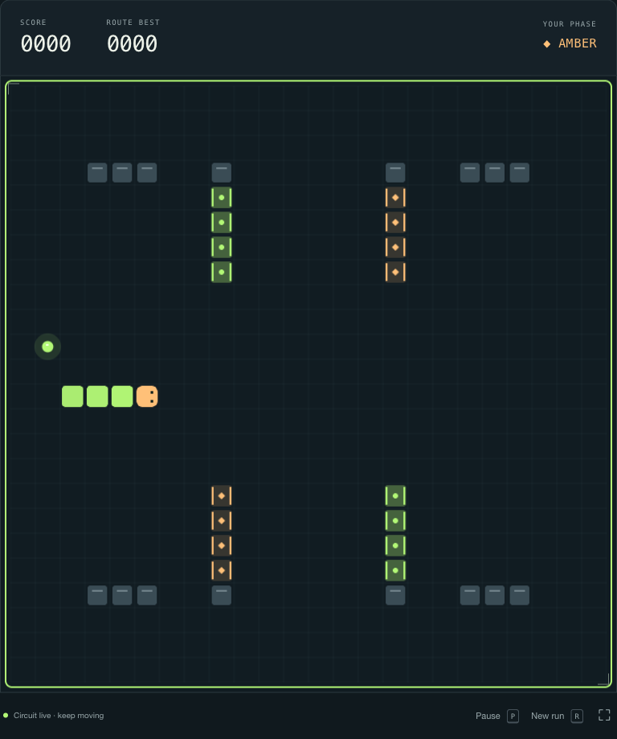

# Switchback

**A familiar game. A different rhythm.**

Switchback is a human-played Snake arcade game for people who enjoy short,
repeatable skill challenges. In Phase run, switch between mint circles and amber
diamonds to collect energy and pass matching gates. Classic removes gates and
phase matching. Daily circuit uses a UTC date seed and a fixed starting pace.

Built with vanilla JavaScript, Canvas 2D, HTML, and CSS. No model training,
inference, automated player, ML libraries, backend, accounts, telemetry, external
fonts, or paid services. All gameplay runs in the browser.



## Run

Install Node.js 22 or newer. From the repository root:

```sh
cd 'Human Game'
npm start
```

Open **http://127.0.0.1:4173**. There are no packages to install and no build step.
Press Ctrl+C in the terminal to stop the server. If the port is busy, run
`PORT=4174 npm start` on macOS/Linux. On PowerShell, run `$env:PORT=4174; npm start`.

Alternatively, run `python3 -m http.server 4173 --bind 127.0.0.1` from this
directory. Serve over HTTP: opening `index.html` with `file://` does not reliably
load JavaScript modules. The bundled server intentionally exposes only the game
assets, not repository files.

Use a current desktop Chrome, Edge, Firefox, or Safari browser. The responsive
layout has touch buttons for phones and tablets; broad device verification is
still on the roadmap. Fullscreen support depends on the browser.

## Play

| Action | Keyboard | Touch / pointer |
| --- | --- | --- |
| Start / retry | Tab to Start run, then Enter | Start run |
| Turn | Arrow keys or WASD | On-screen arrows |
| Switch mint / amber | Space | Shift phase |
| Pause / resume | P or Escape | Pause / Keep going |
| Reset to a new ready run | R | New run |

- Each matching energy pickup earns **100 points** and grows your snake by one.
- Mint uses circles; amber uses diamonds, so hue is not the only cue.
- Shift before **entering** a gate. Gate checks apply to the head; the body can
  trail through it after a phase change. Solid blocks are never passable.
- Unmatched energy stays on the board when you pass over it.
- Touching a boundary, a solid block, your own body, or a wrong-phase gate ends
  the run. Moving into a tail square that vacates on the same step is allowed.
- Classic has no gates, blocks, or phase requirements. Boards do not wrap.
- Pace rises gently every three pickups, with a minimum tick of 65 ms.
- Switching tabs or windows pauses the game. Resume deliberately when you return.
- Route settings are locked during a run; New run resets them for editing.
- A full board completes the circuit without an endless food-placement loop.

## Seeds and records

The same seed, mode, pace, and sequence of inputs produce the same game. Seeds
affect initial gate phase and food placement. Daily circuit uses a UTC date seed,
including the date displayed in its seed field. It is a shared starting condition,
not a guarantee that different player routes will generate the same later food.
Daily runs can be retried without limits; there is no online competition.

Best scores are separated by mode and pace, and daily bests are also separated by
date. The last five completed runs are stored locally in your browser. There are
no player names, logins, cookies, or network score submissions. Clearing records
removes the game's stored data. If browser storage is blocked, scores remain
available only for that visit and the UI reports the limitation.

## Development and verification

```sh
npm run check
npm test
```

The Node built-in test runner checks game and storage behavior with no third-party
test dependencies. GitHub Actions runs these checks when this component changes.
See [QA notes](docs/QA.md) for browser coverage and remaining verification limits.

```text
Human Game/
  index.html, style.css, icon.svg   Interface and original vector artwork
  serve.mjs                         Loopback-only static development server
  src/engine.mjs                    Deterministic rules, independent of the DOM
  src/app.mjs                       Rendering, controls, browser integration
  src/storage.mjs                   Validated local preferences and scores
  tests/                            Rules and persistence regression tests
  ROADMAP.md                        Proposed work remaining after this starter
  docs/                             Goal, architecture, QA, submission notes
```

## Project status

Version **0.1.0** is a playable foundation, created with AI coding assistance in the
existing repository. It does not establish a long history of human maintenance,
users, a deployment, or program eligibility. The [roadmap](ROADMAP.md) describes
substantial unfinished game work; its estimates are planning estimates, not hours
already worked or a certification that the owner planned them independently.

CC-CLI v2 applicants should read [submission notes](docs/SUBMISSION.md). The
organizers must confirm whether they accept this gameplay-only component within
a repository that also contains excluded ML projects.

## License and contributions

MIT, under the repository's [LICENSE](../LICENSE). A matching copy is included in
this directory. New artwork and game source were created for this component; it
does not bundle third-party fonts, audio, datasets, or images.

For a contribution, describe a reproducible gameplay issue or choose a roadmap
item, preserve repository history, and include focused regression coverage for
changed rules. Do not commit credentials or personal data. Keep changes to this
component independent of the repository's ML code.
